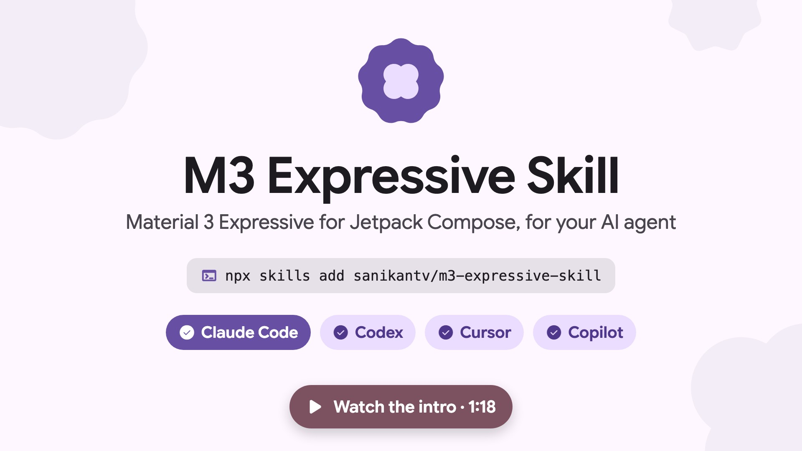

<p align="center"><a href="https://expressive.sanikant.dev/#intro"></a><br /><sub>▶ <a href="https://expressive.sanikant.dev/#intro">Watch the intro</a> · <a href="https://github.com/sanikantv/m3-expressive-skill/raw/main/art/intro.mp4">Download the MP4</a></sub></p>

<h1 align="center">M3 Expressive Skill for Jetpack Compose</h1>

<p align="center">An agent skill that writes Material 3 Expressive Compose code that compiles, for Claude Code, Codex, Cursor and Copilot.</p>

<p align="center"><a href="https://expressive.sanikant.dev"><b>📖 Docs, live demos and guides: expressive.sanikant.dev</b></a> · <a href="https://expressive.sanikant.dev/reference/api-status/">API status by version</a> · <a href="https://expressive.sanikant.dev/components/">Components</a></p>

<p align="center">
  <a href="https://github.com/sanikantv/m3-expressive-skill/actions/workflows/verify.yml"></a>
  
  
  <a href="LICENSE"></a>
</p>

AI agents get M3 Expressive wrong in three ways: they invent APIs, they add `@OptIn` to things
that are already stable (or forget it on things that aren't), and they use APIs that are
`internal` in the material3 version you actually have. This skill fixes that:

- **API status per version.** Which Expressive APIs are stable, opt-in, `internal` or missing in
  material3 1.4.0, the 1.5.0 alphas and 1.5.0-beta02. Built from the published sources, not from
  memory. In beta02 only `LoadingIndicator`, `MaterialShapes` and a few helpers still need
  `@OptIn(ExperimentalMaterial3ExpressiveApi::class)`.
- **Every code sample compiles.** The 28 Kotlin snippets live in [`verify/`](verify/) and CI
  builds them against the pinned material3 version. `scripts/sync_snippets.py` copies them into
  the markdown, so what the agent reads is what compiled.
- **Deprecations since 1.4.0.** `ListItem(headlineContent = …)`, the old `SearchBar`,
  `TopSearchBar`, the non-state `Slider` and more, with the replacement for each.
- **Compose first.** `MaterialExpressiveTheme`, `MotionScheme` springs with their real values,
  the 35 `MaterialShapes` and shape morphing, emphasized type, button groups, toggle and split
  buttons, FAB menu, floating toolbars, flexible app bars, `ShortNavigationBar`,
  `WideNavigationRail`, segmented lists, wavy progress, `LoadingIndicator` and state-based search.
- **Design rules from Google's own material.** The seven tactics and hero moments from the
  [launch post](https://m3.material.io/blog/building-with-m3-expressive), plus patterns seen in
  Google's launch clips: selection changes shape, morph instead of swap, shape contrast for the
  primary action. Also variable-font emphasis and shapes as data highlights.
- **Review mode.** A checklist with grep commands to audit a screen and a report format.

## Install

**Claude Code**: inside a session

```text
/plugin marketplace add sanikantv/m3-expressive-skill
/plugin install m3-expressive-compose@m3-expressive-skill
```

or from your shell:

```bash
claude plugin marketplace add sanikantv/m3-expressive-skill
```

```bash
claude plugin install m3-expressive-compose@m3-expressive-skill
```

Or copy the skill folder into a project (or into `~/.claude/skills/` for every project):

```bash
git clone https://github.com/sanikantv/m3-expressive-skill.git
```

```bash
cp -r m3-expressive-skill/skills/m3-expressive-compose .claude/skills/
```

**Codex, Cursor, Copilot, others**: use the [skills CLI](https://github.com/vercel-labs/skills)

```bash
npx --yes skills add sanikantv/m3-expressive-skill --skill m3-expressive-compose -y
```

or point the agent at `skills/m3-expressive-compose/SKILL.md`.

## Use it

The skill loads on its own when you ask for Compose UI work. Or call it:

```text
/m3-expressive-compose build a settings screen with segmented list items and a floating toolbar
/m3-expressive-compose migrate this screen to M3 Expressive
/m3-expressive-compose review app/src/main/java/.../HomeScreen.kt
```

Example prompts:

- "Add a FAB menu with Share, Edit and Delete to the notes list"
- "Make the paywall CTA a large button that morphs on press"
- "Which of these APIs still need an opt-in on my material3 version?"

## What's inside

```text
skills/m3-expressive-compose/
├── SKILL.md                    rules, old → new component map, workflow, design guidance
└── references/
    ├── expressive-design.md    tactics, hero moments, Google's patterns, variable fonts
    ├── api-status.md           stable / opt-in / internal per version, deprecations
    ├── theme.md                Gradle, MaterialExpressiveTheme, color roles, emphasized type, shapes
    ├── motion.md               MotionScheme, spring values, spatial vs effects
    ├── shapes.md               35 MaterialShapes, clipping, morphing
    ├── components.md           code for every Expressive component
    └── audit.md                review checklist, grep commands, report format
verify/                         Gradle project that compiles every snippet (+ shapes-svg: MaterialShapes → SVG)
scripts/sync_snippets.py        copies compiled snippets into the markdown
site/                           expressive.sanikant.dev (Astro + Starlight), see site/DEPLOY.md
video/                          the intro video (Remotion + ElevenLabs voice), see video/README.md
```

## Keeping it current

When a new material3 version ships:

1. Bump `material3` in [`verify/gradle/libs.versions.toml`](verify/gradle/libs.versions.toml).
2. Fix anything that no longer compiles: `cd verify && ./gradlew :snippets:assembleDebug`
3. Copy the code into the docs: `python3 scripts/sync_snippets.py`
4. Redo the tables in `api-status.md` (the steps are at the bottom of that file).
5. Rebuild the site from the skill: `cd site && npm run build:all && npm run check`

## Related

- [m3-expressive-paywall](https://github.com/sanikantv/m3-expressive-paywall): six M3 Expressive
  paywall screens for Compose, built with the same APIs.
- [hamen/material-3-skill](https://github.com/hamen/material-3-skill): Material 3 across Compose,
  Flutter and web.
- [abhixv/google-m3-expressive-design-skill](https://github.com/abhixv/google-m3-expressive-design-skill):
  M3 Expressive design specs and reference images.

This skill is the Compose code companion to those: fewer design pages, more checked API facts.

## Author

**Sanikant**, Android developer shipping apps on Google Play and the App Store.

- YouTube: [@Sanikant_Kushwaha](https://www.youtube.com/@Sanikant_Kushwaha)
- LinkedIn: [Sanikant Kushwaha](https://www.linkedin.com/in/sanikant-kushwaha-528b1826a/)

## License

[MIT](LICENSE) © 2026 Sanikant. Third-party files and their licenses: [NOTICE.md](NOTICE.md). Material Design is a Google trademark; this project is not
affiliated with Google. API facts come from the Apache 2.0 AndroidX sources.
